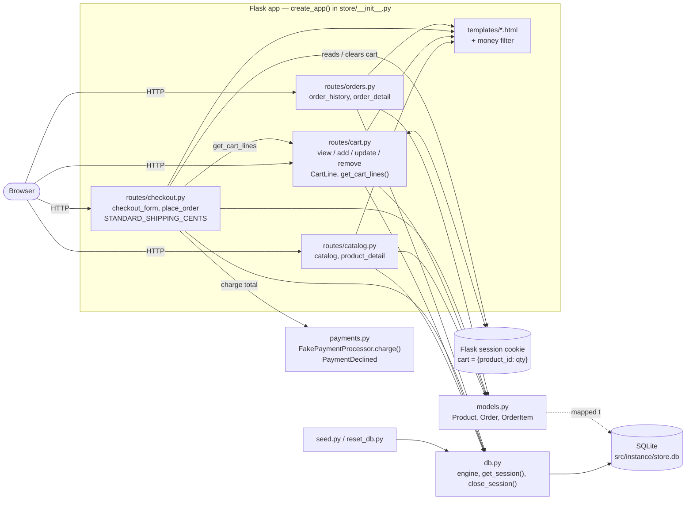

# Milestone 1 — Understand & Establish the Baseline

> **Understand before you redesign.**

## 1. Team & Store

- **Team members:**
  - Emmanuel Arias ([@yair91](https://github.com/yair91))
  - Ana Urrutia ([@anaaurrutiaa](https://github.com/anaaurrutiaa))
  - Lide González ([@lide8](https://github.com/lide8))
  - _TBD_
  - _TBD_
- **Store name:** Tostadero Tapatío
- **Store vertical / concept:** Specialty coffee roaster from Guadalajara
- **Repository:** https://github.com/yair91/commerce-evolution-tostadero-tapatio
- **Short product description:** An online store for Mexican single-origin coffee (Chiapas, Veracruz, Oaxaca) roasted in small batches, plus the brewing gear to make it at home (pour-over dripper, moka pot, clay mug from Tonalá).

## 2. Baseline Validation

We validated the untouched starter before customizing anything, and again after merging our changes.

- [ ] Application runs from a clean setup. `./scripts/verify.sh` creates `.venv`, installs the project, seeds the database and runs the suite; `flask --app store run --debug` serves the store on `http://127.0.0.1:5000`. _Checked by: …_
- [ ] Existing automated tests pass locally. Starter baseline: `12 passed`. After our changes: `13 passed` (one regression test added for a defect we fixed, see below). _Checked by: …_
- [ ] GitHub Actions CI passes. The `tests` workflow is green on `main` and on every pull request (#1–#4).
- [ ] Catalog → cart → checkout → order flow works end-to-end. _Order(s) placed: …_ With `tok_fail` the payment is declined and no order is created.
- [ ] Orders and inventory changes persist after restarting the app. _After restarting Flask, order #… is still in `/orders` and the stock of … went from … to …_

**Defects found while validating (fixed in PR #3, `fix/baseline-defects`):**

1. **Empty cart quantity crashed the app.** In `/cart`, clearing the quantity field and pressing *Update* sends `quantity=""`. `int("")` raised `ValueError` and Flask returned a 500 error. The route now shows an error message and keeps the cart unchanged. Covered by `test_update_cart_with_empty_quantity_keeps_cart`.
2. **`verify.sh` did not reset the database.** The script ran `rm -rf instance` in the project root, but Flask's instance folder is `src/instance/`, so the old `store.db` was never removed. The script now calls `python reset_db.py`, which uses the path Flask actually resolves. We also added `python3.14` to the list of interpreters the script looks for, because it is the only one installed on one of our machines.

## 3. Current System Design

The diagram shows the system as it exists today, without any of the changes we might make later.

## 4. Responsibilities & Dependencies

| Part / module | Main responsibility | Important dependencies |
|---|---|---|
| `store/__init__.py` (`create_app`) | Builds the Flask app: config (`DATABASE`, `STORE_NAME`, `SECRET_KEY`), registers the four blueprints and the `money` template filter. | Flask, `db.init_app`, all route modules |
| `db.py` | Creates the SQLAlchemy engine and session factory, creates tables, gives each request one session (`get_session`) and closes it on teardown. | SQLAlchemy, Flask `g` / `current_app`, SQLite file |
| `models.py` | ORM mapping for `Product`, `Order` and `OrderItem`. `OrderItem` copies `sku`, `product_name` and `unit_price_cents` at purchase time. | `db.Base`, SQLAlchemy |
| `routes/catalog.py` | Lists active products and shows one product. | `get_session`, `Product`, templates |
| `routes/cart.py` | Keeps the cart in the Flask session as `{product_id: quantity}` and turns it into `CartLine` objects with line totals. | Flask `session`, `get_session`, `Product` |
| `routes/checkout.py` | Shows the checkout summary and runs the whole purchase: form validation, stock check, totals, payment, order and items creation, stock decrement, commit, cart reset. | `get_cart_lines` (cart), `FakePaymentProcessor`, `Order`, `OrderItem`, `get_session`, Flask `session` |
| `payments.py` | Simulated payment provider. `charge(amount_cents, token)` returns a `pay_…` reference or raises `PaymentDeclined` (`tok_fail` or empty token). | `uuid` only |
| `routes/orders.py` | Order history and order detail (with items eagerly loaded). | `get_session`, `Order` |
| `templates/` + `static/` | Presentation: storefront identity, catalog, cart, checkout, confirmation, history. | Jinja, data passed by the routes |
| `seed.py` / `reset_db.py` | Development data: delete the SQLite file and load the catalog. | `create_app`, `get_session`, `Product` |

**Main purchase flow (browser request → persisted order):**

1. `POST /cart/add/<id>` (cart) loads the `Product`, checks it is active and increments `session["cart"][id]`.
2. `GET /checkout` (checkout) calls `get_cart_lines(db)` from the cart module, computes the subtotal, adds `STANDARD_SHIPPING_CENTS` (99.00) and renders the summary.
3. `POST /checkout` (checkout, `place_order`):
   1. rebuilds the cart lines from the session and the database;
   2. checks that name, email, address and payment token are present;
   3. checks `quantity <= stock_quantity` for every line;
   4. computes `subtotal` and `total = subtotal + shipping` again;
   5. creates `FakePaymentProcessor()` and calls `charge(total, token)`. A `PaymentDeclined` redirects back to the form and nothing is written;
   6. adds an `Order` with the payment reference and status `"confirmed"`, then `flush()` to get its id;
   7. for each line, appends an `OrderItem` (snapshot of sku, name, unit price, quantity) and subtracts the quantity from `Product.stock_quantity`;
   8. `db.commit()` writes the order, the items and the new stock in one transaction;
   9. clears `session["cart"]` and redirects to `GET /orders/<id>`.
4. `GET /orders/<id>` (orders) loads the order with its items and renders the confirmation. `GET /orders` lists all orders, newest first.

## 5. Design Observations

**O1 — Strength: persistence is well localized.** All database setup lives in `db.py` and all mapping lives in `models.py`. Routes never open connections themselves; they ask for `get_session()`, and the session is closed automatically at the end of the request. Changing the database file or engine settings only touches `create_app` and `db.py`. In addition, `OrderItem` stores a copy of the SKU, name and unit price, so an old order keeps showing what the customer actually paid even if the product is later renamed or its price changes.

**O2 — Reasonable original decision: simple payment and shipping.** The payment provider is one small class with one method (`charge`) and one exception (`PaymentDeclined`), and shipping is a single constant (`STANDARD_SHIPPING_CENTS`). For the current requirements (one fake provider, one shipping option) this is the right size. An interface, a strategy or a factory here would add code with no current benefit. The session-based cart is also reasonable: there are no user accounts, so there is nothing else to attach the cart to.

**O3 — Coupling / design pressure: the purchase sequence lives inside one HTTP handler.** `checkout.place_order` is about 65 lines that mix request parsing, validation, stock rules, price calculation, the payment call, order creation, the inventory update, the commit, the session reset and flash messages. It also creates `FakePaymentProcessor()` directly inside the function. This is where the most important coordination knowledge in the system is, and it can only be exercised through an HTTP request (all checkout tests use the Flask test client). *Observed now:* it works and is covered by tests. *Only if future requirements justify it* (for example a second payment provider, several shipping methods or a purchase that does not come from the web form) would we consider moving that sequence out of the route.

**O4 — Technical debt: the order total is calculated in three places.** `cart.view_cart`, `checkout.checkout_form` and `checkout.place_order` each compute `sum(line.line_total_cents ...)`, and the last two add `STANDARD_SHIPPING_CENTS` separately. Today they agree. If pricing changes (discounts, taxes, shipping by weight), the change has to be repeated in every place, and the price shown to the customer can drift from the price charged.

**O5 — Technical debt: payment happens before the order is saved, and stock is not reserved.** The card is charged first and the order is committed afterwards. If the commit fails, the customer has been charged and there is no order and no refund path. The stock check is also a plain read followed by a later subtraction, with no locking, so two simultaneous checkouts for the last unit could both succeed. With one user on SQLite this does not happen in practice, so we record it as an observation and do not change it in M1.

## 6. AI Use

- **Tool:** Claude (Anthropic), used as a coding and writing assistant.
- **What it helped with:**
  - Drafting the SVG illustrations for the six products and the first version of the product descriptions.
  - A first reading of the code to list responsibilities and dependencies, which we used as a starting point for the table in section 4.
  - Probing edge cases in the cart and checkout routes, which surfaced the empty-quantity crash, and pointing out that `verify.sh` removed the wrong `instance/` folder.
  - Suggesting wording for the design observations and the Mermaid syntax for the diagram.
  - Writing the first version of the storefront changes (copy, palette, seed data), the two defect fixes with their regression test, and the first draft of this document. Every change was submitted as a pull request so the team could review it.
- **What the team did, reviewed and validated:**
  - Chose the store concept, name, products and prices.
  - Ran the setup, the full purchase flow (success and `tok_fail`) and the restart check ourselves, and checked GitHub Actions.
  - Compared every arrow in the diagram and every row of the table against the actual code, and corrected anything that did not match.
  - Reproduced both defects before accepting the fixes, and checked that the new test fails without the fix and passes with it.
  - Decided which observations to keep, which ones are only concerns for later, and that nothing in M1 should be redesigned beyond the two defect fixes.
